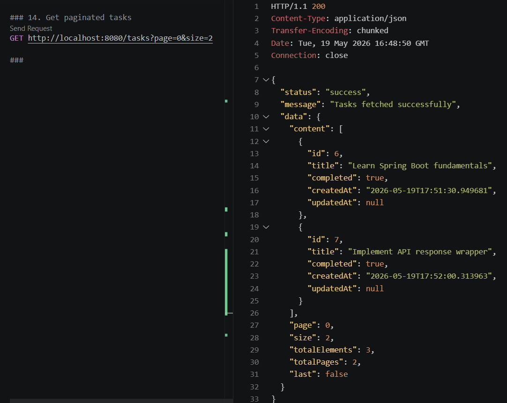
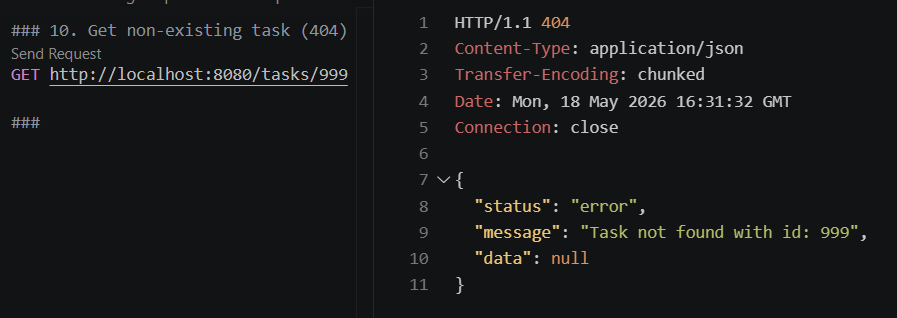
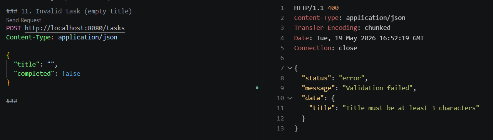

# Backend Learning Journey

A structured Java backend development portfolio documenting my transition from Mechanical Engineering to Backend Development.

This repository showcases my learning and practical implementation of Core Java, Data Structures and Algorithms, Spring Boot, REST APIs, database integration, and backend application development.

The focus is on understanding fundamental concepts, writing maintainable code, solving programming problems, and building practical backend applications.

---

## What This Repository Demonstrates

- **Core Java:** OOPS, Collections Framework, Exception Handling, and Multithreading.
- **Data Structures & Algorithms:** Java-based implementations and problem-solving practice.
- **Backend Development:** REST API development using Spring Boot.
- **Backend Architecture:** Layered architecture, DTO pattern, validation, and exception handling.
- **Database Integration:** PostgreSQL, Spring Data JPA, and Hibernate.
- **Testing:** JUnit 5, Mockito, and MockMvc.
- **Technical Documentation:** Structured Markdown notes for revision and interview preparation.

---

## Technology Stack

| Category | Technologies |
|---|---|
| Programming Language | Java 17 |
| Backend Framework | Spring Boot |
| Web | Spring Web, REST APIs |
| Database | PostgreSQL |
| ORM | Spring Data JPA, Hibernate |
| Build Tool | Maven |
| Testing | JUnit 5, Mockito, MockMvc |
| API Documentation | Swagger / OpenAPI |
| Version Control | Git, GitHub |
| Development Tools | VS Code |

---

## Repository Structure

```text
backend-learning-journey/
│
├── core-java/
│   ├── collections/
│   ├── dsa/
│   ├── exceptionhandling/
│   ├── multithreading/
│   └── oops/
│
├── notes/
│   ├── 00-project-structure.md
│   ├── 01-git-workflow.md
│   ├── ...
│   └── 31-microservices.md
│
├── projects/
│   ├── Othello-Java/
│   └── TicTacToe-Java/
│
├── spring-boot/
│   ├── hello-api/
│   └── task-manager-api/
│
├── sql-practice/
│   └── 01-basic-queries.sql
│
├── README.md
└── .gitignore
```

---

## Core Java

The `core-java/` directory contains independent Java demonstrations and practical implementations.

### Collections Framework

Demonstrations covering:

- Lists: ArrayList, LinkedList
- Sets: HashSet, LinkedHashSet, TreeSet
- Maps: HashMap and custom HashMap implementation
- Queues: Queue, PriorityQueue, ArrayDeque
- Sorting: Comparable and Comparator
- Collection performance comparisons

See [Collections Demos](core-java/collections/README.md).

### Object-Oriented Programming

A payment-system implementation demonstrating:

- Inheritance
- Abstraction
- Interfaces
- Polymorphism
- Payment method implementations
- Refund functionality

### Exception Handling

Demonstrations covering basic exceptions, custom exceptions, and multiple catch blocks.

### Multithreading

Practical examples covering:

- Thread creation
- Runnable interface
- ExecutorService
- Single-thread executors
- Race conditions

---

## Data Structures & Algorithms

The `core-java/dsa/` directory contains Java-based problem-solving implementations.

Current implementation:

### Two Sum

- Problem explanation and approach
- Java implementation
- Problem-solving practice

See [Two Sum](core-java/dsa/arrays/two-sum.md).

Additional implementations will be added as I progress through advanced DSA topics, including trees, recursion, backtracking, dynamic programming, and graphs.

---

## Backend Projects

### Task Manager API

**Location:** `spring-boot/task-manager-api/`

A Spring Boot REST API implementing task management with database persistence.

#### Architecture

Controller → Service → Repository → Database

#### Key Features

- Full CRUD REST API
- Task filtering using query parameters
- Pagination using Pageable and PageRequest
- Custom pagination response with metadata
- Timestamp tracking (`createdAt` / `updatedAt`)
- PostgreSQL integration using Spring Data JPA
- DTO pattern (Request / Response separation)
- Input validation using Jakarta annotations
- Global exception handling using `@RestControllerAdvice`
- Structured logging using SLF4J
- Appropriate HTTP status codes
- Consistent API response format
- Sorting using query parameters
- Interactive API documentation using Swagger / OpenAPI

#### API Endpoints

| Method | Endpoint | Description |
|---|---|---|
| POST | `/tasks` | Create task |
| GET | `/tasks` | Get paginated tasks |
| GET | `/tasks/{id}` | Get task by ID |
| GET | `/tasks?completed=true` | Filter completed tasks |
| GET | `/tasks?page=0&size=5` | Customize pagination |
| GET | `/tasks?page=0&size=5&sortBy=title&direction=asc` | Sort and paginate tasks |
| PUT | `/tasks/{id}` | Update task |
| DELETE | `/tasks/{id}` | Delete task |

#### API Preview

**Get Tasks with Pagination**



**Task Not Found (404)**



**Validation Error (400)**



#### API Documentation

Swagger UI is available when the application is running locally:

`http://localhost:8080/swagger-ui/index.html`

#### Testing

Automated tests cover Controller and Service layers.

**Controller Tests**
- Endpoint response validation
- HTTP status code verification
- Request validation
- Exception handling

**Service Tests**
- Task retrieval
- Task creation
- Task update and deletion
- Exception scenarios
- Filtering logic
- Pagination behavior

**Testing Tools:** JUnit 5, Mockito, MockMvc.

---

### Hello API

**Location:** `spring-boot/hello-api/`

A basic Spring Boot application used for learning application setup and REST API fundamentals.

---

## Standalone Java Projects

### TicTacToe-Java

A standalone Java implementation of the Tic-Tac-Toe game.

### Othello-Java

A Java implementation of the Othello board game, with documented improvement areas.

---

## Learning Notes

The `notes/` directory contains structured Markdown documentation covering Core Java, backend development, Spring Boot, Spring Security, and interview preparation.

Current documentation includes:

- Git workflow and OOPS principles
- Java Collections Framework and its internals
- Exception Handling and Multithreading
- Spring Boot fundamentals and request flow
- Spring MVC and RESTful Web Services
- Spring Data JPA and Hibernate
- Spring Security, JWT, OAuth 2.0 and OIDC
- Actuator, Logging and Metrics
- JUnit Testing and Microservices

**31 structured notes** are currently maintained, with additional documentation added as learning progresses.

See [Project Structure](notes/00-project-structure.md) for the complete documentation index and repository overview.

---

## Learning Progress

| Area | Status |
|---|---|
| Core Java Fundamentals | Completed |
| Java Collections Framework | Completed |
| Exception Handling | Completed |
| Multithreading Fundamentals | Completed |
| DSA Foundations | Completed |
| Spring Boot Fundamentals | Completed |
| Spring Boot Advanced Modules | Completed |
| Advanced DSA | Upcoming |
| Interview Preparation | In Progress |

---

## Future Development

Planned areas of development include:

- Advanced DSA implementations and problem-solving
- Spring Security and JWT-based authentication
- Integration testing with Testcontainers
- Dockerization and deployment
- Role-based authorization
- CI/CD pipeline integration
- Additional backend applications

---

## Goal

To become a job-ready Java Backend Developer by developing strong foundations in Java, Data Structures and Algorithms, Spring Boot, databases, backend architecture, and software engineering practices.

---

This repository represents an ongoing learning journey focused on practical implementation, continuous improvement, and building real backend development skills.